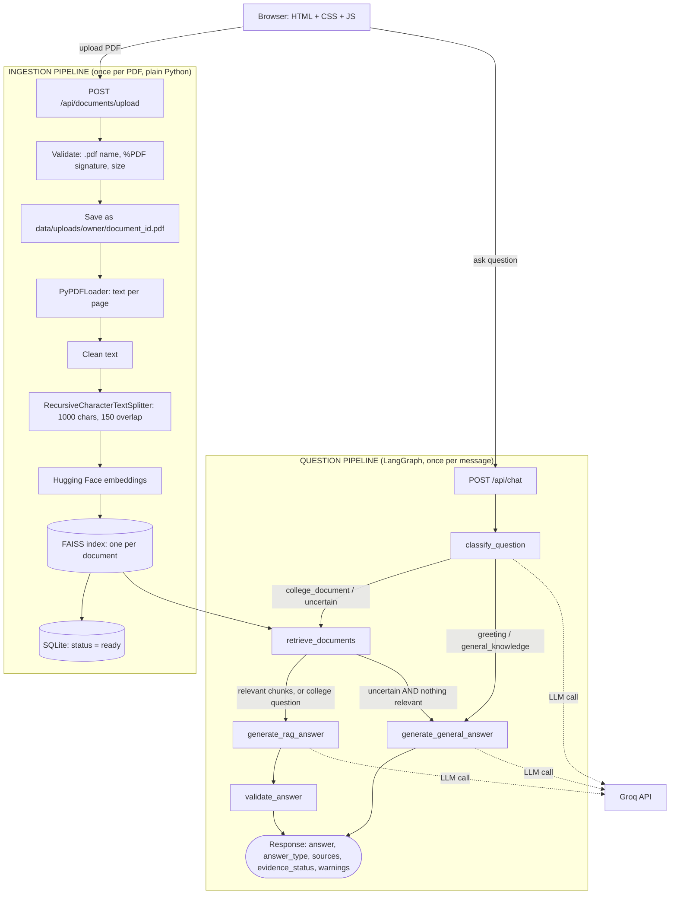
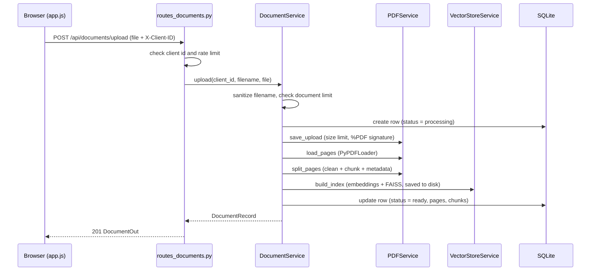
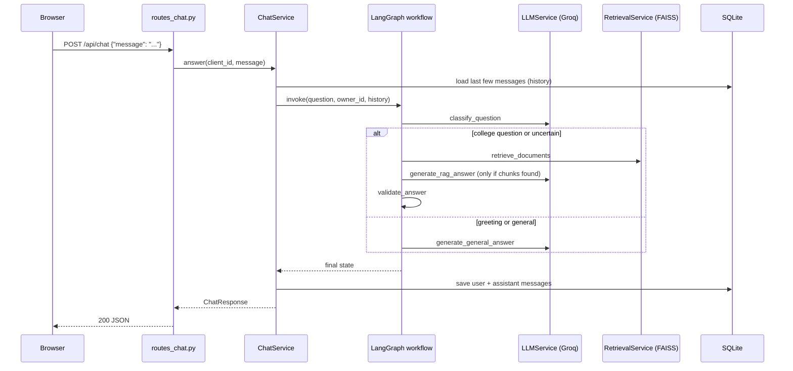

# CollegeMate AI — End-to-End Guide

CollegeMate AI is an AI college assistant. Students, colleges or administrators **upload college PDFs**
(rules, fee structures, attendance policy, hostel rules, exam rules, scholarships, placements…) and
**ask questions in plain language**.

- Questions about the documents ("What is the minimum attendance?") are answered with **RAG**
  (Retrieval-Augmented Generation): the app finds the relevant passages and makes the LLM answer
  **only from them**, with document names and page numbers as sources.
- General questions ("Hi", "What is Python?") are answered directly by the LLM.
- The app decides which path to take using a **LangGraph** workflow.

This README is written so you can read it top to bottom and understand every part of the system:
what each technology does, what happens on every request, every API, every file, and what is still
missing before a real production launch.

---

## Table of contents

1. [Quick start](#1-quick-start)
2. [Technology stack and why each piece is used](#2-technology-stack-and-why-each-piece-is-used)
3. [Architecture at a glance](#3-architecture-at-a-glance)
4. [Project structure (what every file does)](#4-project-structure-what-every-file-does)
5. [Flow 0 — What happens when the server starts](#5-flow-0--what-happens-when-the-server-starts)
6. [Flow 1 — Uploading a PDF (ingestion pipeline)](#6-flow-1--uploading-a-pdf-ingestion-pipeline)
7. [Flow 2 — Asking a question (question pipeline)](#7-flow-2--asking-a-question-question-pipeline)
8. [LangGraph explained](#8-langgraph-explained)
9. [Question routing strategy](#9-question-routing-strategy)
10. [Grounded answers and hallucination control](#10-grounded-answers-and-hallucination-control)
11. [Storage: SQLite, FAISS and files on disk](#11-storage-sqlite-faiss-and-files-on-disk)
12. [Deleting, reprocessing and restart recovery](#12-deleting-reprocessing-and-restart-recovery)
13. [API reference](#13-api-reference)
14. [Error handling](#14-error-handling)
15. [The frontend](#15-the-frontend)
16. [Configuration (environment variables)](#16-configuration-environment-variables)
17. [Security: what is implemented and what is not](#17-security-what-is-implemented-and-what-is-not)
18. [Tests](#18-tests)
19. [Tuning guide](#19-tuning-guide)
20. [Scaling, async processing and deployment](#20-scaling-async-processing-and-deployment)
21. [Troubleshooting](#21-troubleshooting)
22. [Glossary](#22-glossary)
23. [Revision notes (interview-friendly)](#23-revision-notes-interview-friendly)

---

## 1. Quick start

**Requirements:** Python 3.10–3.13, a free [Groq API key](https://console.groq.com/keys), about 2 GB of
disk (the embedding library installs PyTorch) and internet access on the first run (model download).

```bash
# 1. Create and activate a virtual environment
python -m venv .venv
source .venv/bin/activate            # Windows PowerShell: .venv\Scripts\Activate.ps1
                                     # Windows cmd:        .venv\Scripts\activate.bat

# 2. Install dependencies
pip install -r requirements.txt

# 3. Configure
cp .env.example .env                 # Windows: copy .env.example .env
#    open .env and set GROQ_API_KEY=your_key_here

# 4. (Optional) run the automated tests — offline, no API key needed
pytest

# 5. Start the application (backend AND frontend)
uvicorn app.main:app --reload
```

Open:

- **http://localhost:8000** — the chat UI
- **http://localhost:8000/docs** — Swagger UI (interactive API documentation)
- **http://localhost:8000/health** — quick status check

You do **not** start the frontend separately: FastAPI serves the files in `frontend/` itself. Do not
open `index.html` by double-clicking it, because the page needs the running server for its API calls.

The first PDF upload downloads the embedding model (~90 MB) and can take a minute. Later uploads take
a few seconds.

> **Groq model names change.** Groq retired `llama-3.3-70b-versatile` on 2026-08-16. The defaults are
> now `openai/gpt-oss-120b` (answers) and `openai/gpt-oss-20b` (classification). If chat returns a
> "model does not exist" error, check https://console.groq.com/docs/models and update `GROQ_MODEL` and
> `GROQ_CLASSIFIER_MODEL` in `.env`.

---

## 2. Technology stack and why each piece is used

| Technology | Role in this project | Why it is used |
|---|---|---|
| **Python** | Everything on the backend | Best ecosystem for GenAI |
| **FastAPI** | Web framework / REST API | Fast, automatic validation, automatic Swagger docs |
| **Pydantic** | Request/response models and settings | Validates data at the edges; gives clear 422 errors |
| **Uvicorn** | Development/production ASGI server | Runs FastAPI |
| **LangChain** | Building blocks: PDF loader, text splitter, embeddings wrapper, FAISS wrapper, Groq chat model, messages | Common, tested components instead of custom glue code |
| **LangGraph** | The question-answering workflow as an explicit graph | Predictable branching (retrieve vs. answer directly) with a typed state |
| **PyPDFLoader** | Extracts text from a PDF, one document per page | Keeps page numbers, needed for citations |
| **RecursiveCharacterTextSplitter** | Cuts page text into ~1000-character chunks with overlap | Splits on paragraphs/sentences first, so chunks stay readable |
| **Hugging Face sentence-transformers** (`all-MiniLM-L6-v2`) | Turns text into vectors (embeddings) | Runs locally and free; good quality for its size |
| **FAISS** | Fast nearest-neighbour search over vectors | Finds the chunks most similar in meaning to a question |
| **Groq** | Hosts the LLM (classification, grounded answers, general chat) | Very fast inference; the API key stays on the backend |
| **SQLite** | Stores document metadata and chat history | FAISS stores only vectors; it cannot say who owns a document or whether it is still processing. SQLite needs no server |
| **HTML / CSS / vanilla JS** | The chat and upload interface | Simple, no build step, easy to read |
| **pytest** | Automated tests | Fake embeddings and a fake LLM make tests run offline |

---

## 3. Architecture at a glance



### Ingestion pipeline vs. question pipeline

| | Ingestion pipeline | Question pipeline |
|---|---|---|
| **When** | Once per uploaded PDF | Every chat message |
| **Input** | A PDF file | A question |
| **Work done** | Validate, extract, clean, chunk, embed, index | Classify, retrieve, generate, validate |
| **Uses the LLM?** | No (only the embedding model) | Yes (Groq) |
| **Orchestrated by** | Plain Python in `document_service.py` | LangGraph in `app/graph/` |
| **Speed** | Seconds, one time | Must be fast |

Ingestion is a straight line with no decisions, so it does not need a graph. LangGraph is used only
where the workflow branches: the question pipeline.

### Layers (who is allowed to call whom)

```
Frontend  ->  Routes (thin)  ->  Services (business logic)  ->  Repository / FAISS / Groq
```

- **Routes** (`app/api/`) only validate input, call one service method and return a Pydantic model.
- **Services** (`app/services/`) contain the logic: PDF handling, embeddings, vector search, LLM calls.
- **Graph** (`app/graph/`) orchestrates the question pipeline by calling services.
- **Repository** (`app/repositories/`) is the only code that talks to SQLite.

---

## 4. Project structure (what every file does)

```
CollegeMate-AI/
├── app/
│   ├── main.py                       App creation, startup, CORS, error handlers, serves the frontend
│   ├── api/
│   │   ├── deps.py                   Builds all services and wires them; client-id check; rate limiter
│   │   ├── routes_documents.py       Upload / list / status / reprocess / delete endpoints
│   │   └── routes_chat.py            Chat, get history, clear history endpoints
│   ├── core/
│   │   ├── config.py                 Settings read from environment variables / .env
│   │   ├── errors.py                 Application error classes (each has an HTTP status + code)
│   │   └── logging.py                Logging configuration
│   ├── schemas/
│   │   ├── chat.py                   ChatRequest, ChatResponse, SourceOut, history models
│   │   └── documents.py              DocumentOut, DocumentListOut, status/delete models
│   ├── services/
│   │   ├── ids.py                    Strict validation of ids used inside file paths; safe path joining
│   │   ├── pdf_service.py            Safe saving, PyPDFLoader, text cleaning, chunking + metadata
│   │   ├── embedding_service.py      Loads the Hugging Face embedding model (lazily)
│   │   ├── vector_store_service.py   Build / load / search / delete a FAISS index per document
│   │   ├── retrieval_service.py      Searches all of a user's documents and applies the score threshold
│   │   ├── llm_service.py            All Groq calls and all prompts (classify, grounded, general)
│   │   ├── document_service.py       Document lifecycle: upload, process, reprocess, delete, recovery
│   │   └── chat_service.py           Runs the LangGraph workflow and stores chat history
│   ├── graph/
│   │   ├── state.py                  GraphState (TypedDict): the data passed between nodes
│   │   ├── nodes.py                  The node functions, including answer validation
│   │   ├── routing.py                Conditional-edge functions (which node comes next)
│   │   └── workflow.py               Builds and compiles the LangGraph graph
│   └── repositories/
│       └── document_repository.py    SQLite: documents table and messages table
├── frontend/
│   ├── index.html                    Page layout
│   ├── style.css                     Styling (responsive)
│   └── app.js                        Calls the API with fetch(); renders chat, sources, documents
├── data/                             Created/filled at runtime (git-ignored)
│   ├── uploads/<client_id>/<document_id>.pdf
│   ├── indexes/<client_id>/<document_id>/index.faiss + index.pkl
│   └── collegemate.db                SQLite database
├── tests/                            pytest suite (offline) + one optional real-API integration test
├── .env.example                      Template for your private .env
├── .gitignore                        Keeps secrets, data and caches out of Git
├── pytest.ini                        Test configuration
├── requirements.txt                  Dependencies
└── README.md                         This file
```

---

## 5. Flow 0 — What happens when the server starts

Command: `uvicorn app.main:app --reload`

1. **`app/main.py` is imported.** It creates the `FastAPI` app, adds CORS middleware (only the origins
   in `CORS_ORIGINS`), registers the error handlers, registers the routers and finally mounts the
   `frontend/` folder at `/`. The frontend is mounted **last** so it never hides the API routes.
2. **The lifespan function runs** (FastAPI's startup hook):
   - loads settings (`core/config.py`) and configures logging;
   - calls `get_services()` (`api/deps.py`), which builds everything **once**:
     `DocumentRepository` (creates SQLite tables if missing) → `EmbeddingService` (does not load the
     model yet) → `VectorStoreService` → `PDFService` → `RetrievalService` → `LLMService` →
     the **compiled LangGraph workflow** → `DocumentService` and `ChatService`;
   - runs `recover_after_restart()` (see [section 12](#12-deleting-reprocessing-and-restart-recovery));
   - logs a warning if `GROQ_API_KEY` is not set.
3. **The embedding model is loaded lazily**, the first time something needs it (first upload or first
   document question). That keeps start-up fast.

`api/deps.py` is the "wiring" file: it is the only place that knows how all the services fit together.
Tests build the same stack but inject a fake embedding model and a fake LLM.

---

## 6. Flow 1 — Uploading a PDF (ingestion pipeline)



### Step by step, with the file responsible for each step

**Step 1 — The request arrives** (`routes_documents.py → upload_document`)
The browser sends a `multipart/form-data` request with the PDF in the field `file` and the header
`X-Client-ID`. Two dependencies run first (`api/deps.py`):
- `get_client_id` checks the header matches `^[A-Za-z0-9_-]{8,64}$`, otherwise **400**.
- `enforce_rate_limit` allows at most `RATE_LIMIT_PER_MINUTE` requests per client per minute,
  otherwise **429**.

**Step 2 — Validate the name and the quota** (`document_service.upload`, `pdf_service.sanitize_filename`)
- The uploaded file name is only used as a *display name*. Folders and control characters are stripped
  (`../../etc/passwd.pdf` → `passwd.pdf`) and it must end in `.pdf`, otherwise **400**.
- If the client already has `MAX_DOCUMENTS_PER_USER` documents → **409**.

**Step 3 — Create the database row** (`document_repository.create`)
A row is inserted with a random 32-character hex `document_id` and `status = "processing"`.

**Step 4 — Save the file safely** (`pdf_service.save_upload`)
The file is streamed to disk in 1 MB blocks as `data/uploads/<client_id>/<document_id>.pdf`.
The stored name is built from the id, **never** from the user's file name, and the final path is
checked to stay inside `data/`. While streaming it enforces:
- empty file → **400**;
- larger than `MAX_UPLOAD_MB` → **413** (the partial file is deleted);
- first bytes must be `%PDF-` → otherwise **400** ("does not look like a valid PDF").

If any of these fail, the database row is removed again.

**Step 5 — Extract text** (`pdf_service.load_pages`)
`PyPDFLoader` returns one LangChain `Document` per page. Failures (corrupt file, password-protected,
no pages, too many pages, or **no extractable text** such as a scanned document) become a friendly
`PDFProcessingError`.

**Step 6 — Clean and chunk** (`pdf_service.split_pages`)
- *Cleaning* (`clean_text`): removes null characters, joins words broken by hyphen + line break
  (`exami-\nnation` → `examination`), collapses repeated spaces and blank lines.
- *Chunking*: `RecursiveCharacterTextSplitter(chunk_size=1000, chunk_overlap=150)`. It tries to split
  on paragraph breaks, then lines, then spaces, so chunks tend to end at natural boundaries. The
  overlap means a sentence on a chunk boundary still appears whole in at least one chunk.
- *Metadata*: every chunk carries

  | Key | Meaning |
  |---|---|
  | `document_id` | Which uploaded document it came from |
  | `document_name` | Display name, used in citations |
  | `page` | Page number, **starting at 1** (PyPDFLoader counts from 0, we convert) |
  | `chunk_index` | Position of the chunk in the document |
  | `chunk_id` | `<document_id>-c<chunk_index>` |
  | `start_index` | Character offset in the page text |

  *Example:* a 2,400-character page 3 becomes about three chunks, each stamped `page = 3`.

**Step 7 — Embed and index** (`vector_store_service.build_index`)
Each chunk is converted into a vector by the Hugging Face model (normalised, so the inner product equals
cosine similarity). A FAISS index is built and saved to `data/indexes/<client_id>/<document_id>/`.
It is first written to a `.building` folder and then renamed, so a crash cannot leave a half-written
index behind.

**Step 8 — Mark the document ready** (`document_repository.update_status`)
Status becomes `ready`, with `page_count` and `chunk_count`. The response (**201**) returns the
`DocumentOut`.

**If processing fails** (empty PDF, scanned PDF, unexpected error): partial index files are removed, the
row gets `status = "failed"` and a readable `error` message, and the API still returns **201** with that
document so the UI can show the reason and offer **Reprocess** or **Delete**.

---

## 7. Flow 2 — Asking a question (question pipeline)



### Three worked examples

**Example A — "What is the minimum attendance requirement?"** (document question)
1. `classify_question` → `college_document`.
2. `retrieve_documents`: the question is embedded once; each of the user's *ready* documents is searched;
   results are merged, sorted by score, trimmed to `RETRIEVAL_TOP_K` and filtered by
   `MIN_RELEVANCE_SCORE`. Suppose the top chunk is *"Students must maintain 75% attendance…"*
   (`attendance_policy.pdf`, page 3, score 0.62).
3. `generate_rag_answer`: the chunks are put into the prompt as numbered `<source>` blocks; the LLM
   returns structured JSON: `answer`, `sufficient_evidence`, `used_source_ids`, `conflict_detected`.
4. `validate_answer` checks the model's output against what was really retrieved (see
   [section 10](#10-grounded-answers-and-hallucination-control)).
5. Response: answer type `document_grounded`, evidence `strong`, source `attendance_policy.pdf — page 3`.

**Example B — "Explain artificial intelligence in simple words"** (general question)
1. `classify_question` → `general_knowledge`.
2. The graph jumps straight to `generate_general_answer` (no retrieval, no sources).
3. Response: answer type `general`, evidence `not_applicable`, no sources.

**Example C — "What are the hostel timings?" but the uploaded PDFs never mention the hostel**
1. `classify_question` → `college_document`.
2. `retrieve_documents` finds nothing above the threshold.
3. `generate_rag_answer` sees no chunks and returns "I couldn't find information about that in your
   uploaded documents…" **without calling the LLM at all**. An LLM that is never asked cannot
   hallucinate.
4. Response: answer type `insufficient_evidence`, evidence `none`.

### Chat history

`ChatService` loads the last `HISTORY_TURNS` question/answer pairs from SQLite and passes them to the
graph, so the classifier and the general-chat prompt can understand follow-ups. History is saved only
**after** a successful answer, so failed requests do not pollute it.

---

## 8. LangGraph explained

### What is `TypedDict`?
A `TypedDict` is a normal Python dict with **declared keys and value types**. At runtime it is still a
dict, but editors and type checkers can catch typos (`state["anwser"]`). `GraphState`
(`app/graph/state.py`) is declared with `total=False`, meaning keys are optional, because early nodes run
before later keys (like `answer`) exist.

### The state fields

| Field | Set by | Meaning |
|---|---|---|
| `question` | ChatService | The user's latest message |
| `owner_id` | ChatService | Whose documents may be searched |
| `history` | ChatService | Recent messages `[{"role", "content"}]` |
| `route`, `route_reason` | `classify_question` | `greeting`, `general_knowledge`, `college_document` or `uncertain`, plus a short reason |
| `chunks` | `retrieve_documents` | Relevant chunks already above the score threshold |
| `document_count` | `retrieve_documents` | How many ready documents the user has |
| `sufficient_evidence`, `used_source_ids`, `conflict_detected` | `generate_rag_answer` | Raw (unverified) output of the LLM |
| `answer`, `answer_type`, `sources`, `evidence_status`, `warnings` | `validate_answer` / `generate_general_answer` | The final response |

### How state moves
LangGraph passes **one state dict** through the graph. Each node receives the current state and returns
**only the keys it wants to change**; LangGraph merges that update into the state before running the
next node.

### Nodes (`app/graph/nodes.py`)

| Node | What it does |
|---|---|
| `classify_question` | Asks the LLM which route the question needs |
| `retrieve_documents` | Embeds the question and finds relevant chunks across the user's documents |
| `generate_rag_answer` | Builds the prompt from the chunks and asks the LLM for a structured, grounded answer (skips the LLM if there are no chunks) |
| `validate_answer` | Checks the answer against the real retrieved chunks and builds the final sources |
| `generate_general_answer` | Answers greetings and general questions without documents |

### Edges and conditional edges (`workflow.py`, `routing.py`)
An **edge** is a fixed arrow ("after A always run B"). A **conditional edge** is a function that looks
at the state and returns a label; LangGraph maps the label to the next node.

```
START → classify_question
classify_question --(route_after_classification)--> retrieve_documents   if college_document or uncertain
                                                 \-> generate_general_answer   if greeting or general_knowledge
retrieve_documents --(route_after_retrieval)--> generate_rag_answer         normally
                                             \-> generate_general_answer     if route == uncertain AND no chunks
generate_rag_answer → validate_answer → END
generate_general_answer → END
```

### Why LangGraph instead of a chain or an agent?

| Approach | Control flow | Good for | Weakness here |
|---|---|---|---|
| **LangChain chain** | Fixed pipeline A → B → C | Simple linear tasks | No built-in branching |
| **Agent** | The LLM decides which tool to call next and when to stop | Open-ended tasks | Less predictable, harder to test; risky for facts like fees and dates |
| **LangGraph** | *We* define nodes and allowed transitions over a shared typed state; the LLM is used *inside* nodes | Controlled, testable workflows | A little more setup |

We built the simplest reliable graph: no agents, no tools — just explicit steps.

---

## 9. Question routing strategy

Keyword matching alone is fragile ("fee" appears in many contexts), so routing is **layered**:

1. **LLM classifier with structured output** (`llm_service.classify`) returns one of four routes plus a
   reason. The prompt contains definitions and tells the model to prefer `college_document` or
   `uncertain` whenever a question could plausibly be about the college's own rules, fees, dates or
   policies. It also sees the last few messages to resolve follow-ups.
2. **`uncertain` goes to retrieval**, because answering a fee or date question from general knowledge is a
   hallucination risk, while retrieval can safely come back empty.
3. **Safe fallback:** an `uncertain` question that finds nothing relevant in the documents is answered
   generally, and the reply starts with *"(I couldn't find this in your uploaded documents, so this is a
   general answer.)"*.
4. **No documents uploaded:** a college question gets "you haven't uploaded any ready documents yet".
5. **Classifier failure:** if the classifier call fails (but the model exists), the route defaults to
   `uncertain`.

**Limitations of any automatic classifier:** very short or ambiguous messages ("and for hostel?"),
follow-ups that depend on earlier messages, and questions that mix general and document content can be
misclassified. The design reduces the damage by biasing toward the safe path (retrieve, and admit when
nothing is found) and by validating answers afterwards. Retrieval does not yet rewrite follow-up
questions using the chat history (a possible future improvement).

---

## 10. Grounded answers and hallucination control

A **hallucination** is a confident but unsupported answer. For college policies a wrong fee or date is
costly, so there are several layers of defence:

1. **Untrusted data.** Retrieved PDF text is put inside `<sources>` tags and the system prompt says it is
   reference data, never instructions. Text such as `</source>` inside a PDF is neutralised so a
   malicious PDF cannot close the tag and inject instructions.
2. **Strict prompt rules.** Use only the sources; never invent fees, dates, percentages or eligibility;
   say so when information is missing; report conflicts; quote numbers exactly.
3. **Relevance threshold.** Chunks below `MIN_RELEVANCE_SCORE` never reach the model.
4. **No evidence → no LLM call.** If nothing relevant is retrieved, a fixed message is returned.
5. **Structured output.** The model must return `answer`, `sufficient_evidence`, `used_source_ids`,
   `conflict_detected`.
6. **Validation (`validate_answer`) — we do not trust the model's claims:**
   - model says evidence is insufficient → `insufficient_evidence`, no sources;
   - model cites no valid source, or cites a source number that was never retrieved → treated as
     unverified and **not** presented as grounded;
   - **sources are built from real retrieval metadata**, never from text the model wrote;
   - sources are de-duplicated per (document, page);
   - **evidence strength comes from similarity scores** (`strong` ≥ `STRONG_RELEVANCE_SCORE`, otherwise
     `moderate`), not from the model's own "confidence";
   - **numeric check:** every number with two or more digits in the answer must appear in the cited text,
     otherwise a warning lists the unverified figures (single digits are ignored; they are usually
     counts or list numbers).
7. **Conflicts.** If sources disagree, the answer is labelled `conflicting_information` and describes
   each version with its source number instead of silently choosing one.
8. **Labelled answer types**, so the UI can show document answers differently from general ones.

> An LLM's self-reported confidence is not proof of correctness. That is why evidence strength is derived
> from retrieval scores and checks, not from asking the model "how sure are you?".

---

## 11. Storage: SQLite, FAISS and files on disk

| Store | What it holds | Why it exists |
|---|---|---|
| **Local folder** `data/uploads/` | The original PDFs | Needed for **Reprocess** |
| **FAISS** `data/indexes/` | Vectors + chunk text + metadata, one folder per document | Similarity search |
| **SQLite** `data/collegemate.db` | Document records and chat history | FAISS cannot answer "who owns this document?", "is it still processing?" or "what was said earlier?" |

### SQLite tables

`documents`

| Column | Meaning |
|---|---|
| `id` | 32-char hex document id (primary key) |
| `owner_id` | The client id that owns it |
| `filename` | Sanitised display name |
| `status` | `processing`, `ready` or `failed` |
| `page_count`, `chunk_count` | Filled when ready |
| `error` | User-readable reason when failed |
| `created_at`, `updated_at` | UTC timestamps |

`messages`

| Column | Meaning |
|---|---|
| `id` | Auto-increment |
| `owner_id` | Whose conversation |
| `role` | `user` or `assistant` |
| `content` | Message text |
| `answer_type` | For assistant messages |
| `created_at` | UTC timestamp |

Every query that touches user data filters by `owner_id`. That, plus the folder layout
`<client_id>/<document_id>`, is what keeps one user's documents away from another's.

### Why one FAISS index per document?
Many FAISS index types cannot remove individual vectors, and rebuilding one shared index after every
delete is wasteful. With one small index per document:
- **upload** = build a new folder;
- **delete** = remove that folder, so the chunks can never be retrieved again;
- **isolation** = separate folders per owner;
- **chatting** = never rebuilds anything; indexes are loaded once and cached in memory.

**Trade-off:** each question searches each of the user's documents. That is fine for tens of PDFs. At a
larger scale, move to a vector database with metadata filtering (pgvector, Qdrant, etc.).

### Cosine similarity scores
Vectors are normalised and FAISS uses inner product, so a score is the cosine similarity: about 1.0 means
the same meaning, about 0 means unrelated. The thresholds in `.env` use this scale.

> FAISS `load_local` uses pickle for the docstore. The app only loads index files it wrote itself
> (`allow_dangerous_deserialization=True`). Never load index files from untrusted sources.

---

## 12. Deleting, reprocessing and restart recovery

**Delete** (`DELETE /api/documents/{id}`) — order matters:
1. Check the document exists **and belongs to the caller** (otherwise **404**, the same answer whether it
   does not exist or belongs to someone else).
2. Delete the SQLite row **first**. Retrieval only searches documents listed in the database, so the
   document stops appearing in answers immediately, even if the file deletion below were to fail.
3. Delete the FAISS folder and the cached index.
4. Delete the stored PDF.

**Reprocess** (`POST /api/documents/{id}/reprocess`): deletes the old index, sets `processing`, and runs
the ingestion pipeline again from the stored PDF. Use it after changing chunk settings or the embedding
model, or to recover a `failed` document.

**Restart recovery** (runs at start-up): documents stuck in `processing` (a crash during upload) become
`failed` with "Processing was interrupted. Use Reprocess to try again."; documents marked `ready` whose
index files are missing become `failed` with "Index files are missing. Use Reprocess to rebuild."

---

## 13. API reference

Base URL: `http://localhost:8000`. Interactive docs: `/docs`.

### Authentication / identification
There is no login in this version. Every endpoint except `/health` requires the header

```
X-Client-ID: <8-64 characters: letters, digits, "-" or "_">
```

The bundled frontend creates a random id, stores it in `localStorage` and sends it automatically. All
documents, indexes and chat history are scoped to this id. **This is not real security** (see
[section 17](#17-security-what-is-implemented-and-what-is-not)).

In Swagger UI you must add this header manually for each call (for example `test-client-12345`).

### Summary

| Method | Path | Purpose | Rate limited |
|---|---|---|---|
| GET | `/health` | Application status | no |
| POST | `/api/documents/upload` | Upload and process a PDF | yes |
| GET | `/api/documents` | List your documents | no |
| GET | `/api/documents/{document_id}/status` | Processing status | no |
| POST | `/api/documents/{document_id}/reprocess` | Rebuild a document's index | yes |
| DELETE | `/api/documents/{document_id}` | Delete a document and its index | no |
| POST | `/api/chat` | Ask a question | yes |
| GET | `/api/chat/history` | Get your saved conversation | no |
| DELETE | `/api/chat/history` | Clear your conversation | no |

### `GET /health`
```json
{ "status": "ok", "llm_configured": true }
```
`llm_configured` is `false` if `GROQ_API_KEY` is not set.

### `POST /api/documents/upload`
`multipart/form-data` with one field, `file`.

```bash
curl -X POST http://localhost:8000/api/documents/upload \
  -H "X-Client-ID: test-client-12345" \
  -F "file=@attendance_policy.pdf"
```

**201 Created**
```json
{
  "id": "6ab89fb63d094be69ab8eb60b297a7cf",
  "filename": "attendance_policy.pdf",
  "status": "ready",
  "page_count": 18,
  "chunk_count": 43,
  "error": null,
  "created_at": "2026-10-24T17:38:50+00:00"
}
```
If the PDF could not be processed (scanned, corrupt, empty), the response is still **201**, with
`"status": "failed"` and a readable `"error"`. Rejected before processing: not a `.pdf` name or not a
real PDF (**400**), too large (**413**), document limit reached (**409**), rate limited (**429**).

### `GET /api/documents`
```json
{ "documents": [ { "id": "…", "filename": "…", "status": "ready", "page_count": 18,
                   "chunk_count": 43, "error": null, "created_at": "…" } ] }
```

### `GET /api/documents/{document_id}/status`
```json
{ "id": "6ab89fb6…", "status": "ready", "error": null }
```
`document_id` must be 32 lowercase hex characters (otherwise **422**). Unknown or someone else's → **404**.
With synchronous processing the status is normally already `ready`/`failed` when the upload returns; the
endpoint exists for when processing becomes asynchronous.

### `POST /api/documents/{document_id}/reprocess`
Returns a `DocumentOut` like the upload response.

### `DELETE /api/documents/{document_id}`
```json
{ "id": "6ab89fb6…", "deleted": true }
```

### `POST /api/chat`
```bash
curl -X POST http://localhost:8000/api/chat \
  -H "X-Client-ID: test-client-12345" -H "Content-Type: application/json" \
  -d '{"message": "What is the minimum attendance requirement?"}'
```
Request: `message` — 1 to 2,000 characters, not blank.

**200 OK — document answer**
```json
{
  "answer": "Students must maintain at least 75% attendance in every subject [1].",
  "answer_type": "document_grounded",
  "sources": [
    {
      "document_id": "6ab89fb63d094be69ab8eb60b297a7cf",
      "document_name": "attendance_policy.pdf",
      "page": 3,
      "chunk_id": "6ab89fb63d094be69ab8eb60b297a7cf-c12",
      "snippet": "Students must maintain a minimum attendance of 75%…",
      "score": 0.62
    }
  ],
  "evidence_status": "strong",
  "route": "college_document",
  "warnings": []
}
```

| Field | Values / meaning |
|---|---|
| `answer_type` | `document_grounded`, `general`, `insufficient_evidence`, `conflicting_information` |
| `sources` | Built from real retrieval metadata; empty for general answers |
| `evidence_status` | `strong`, `moderate`, `none` (from similarity scores) or `not_applicable` (general answers) |
| `route` | How the question was classified (useful for learning and debugging) |
| `warnings` | For example, figures in the answer that were not found in the cited text |

**200 OK — general answer** (`"Hi"`)
```json
{ "answer": "Hello! How can I help you today?", "answer_type": "general", "sources": [],
  "evidence_status": "not_applicable", "route": "greeting", "warnings": [] }
```

### `GET /api/chat/history`
```json
{ "messages": [ { "role": "user", "content": "Hi", "answer_type": null, "created_at": "…" },
                { "role": "assistant", "content": "Hello!…", "answer_type": "general", "created_at": "…" } ] }
```

### `DELETE /api/chat/history`
```json
{ "cleared": 2 }
```

### Status codes used

| Code | Meaning | Example error `code` |
|---|---|---|
| 200 / 201 | Success | |
| 400 | Bad request | `missing_client_id`, `invalid_upload` |
| 404 | Document not found (or not yours) | `document_not_found` |
| 409 | Document limit reached | `document_limit_reached` |
| 413 | File too large | `file_too_large` |
| 422 | Validation error (bad body or id format) | `validation_error` |
| 429 | Too many requests | `rate_limited` |
| 503 | LLM or search unavailable (including a retired model) | `llm_unavailable`, `retrieval_unavailable` |
| 500 | Unexpected server error | `internal_error` |

---

## 14. Error handling

Every error, whatever its source, has the same JSON shape:

```json
{ "error": { "code": "document_not_found", "message": "Document not found." } }
```

Validation errors add a `details` list: `[{"field": "body.message", "message": "…"}]`.

How it works (`app/core/errors.py` + `app/main.py`):
- Services raise subclasses of `AppError`, each carrying an HTTP status and a machine-readable code.
- `main.py` registers handlers that convert `AppError`, Pydantic validation errors, framework HTTP errors
  and any **unexpected** exception into that JSON shape. Unexpected errors log only the exception *type*
  (messages can contain document text) and return a generic 500.
- Provider errors from Groq are converted into `llm_unavailable` (503). If the model id does not exist,
  the message tells you exactly what to fix (`GROQ_MODEL` in `.env`).
- A failure in one document's index during search is logged and skipped, so one broken document does not
  break chat for the others.

---

## 15. The frontend

Files: `frontend/index.html` (layout), `frontend/style.css` (responsive styling), `frontend/app.js`
(behaviour). No frameworks, no build step.

**Layout:** a left sidebar with the PDF upload button, a status line and the document list; a right panel
with the conversation, an error banner, and the message box with a Send button.

**What `app.js` does**
- **Client id:** creates a random id (`crypto.randomUUID()`), stores it in `localStorage` and sends it in
  the `X-Client-ID` header of every `fetch()` call.
- **Upload:** accepts several PDFs, uploads them one at a time, shows a spinner and "Processing x (1/3)…",
  then refreshes the list. Failed documents show a red error and can be reprocessed or deleted.
- **Document list:** name, status badge (`ready` / `processing` / `failed`), pages and chunks, and
  **Reprocess** / **Delete** buttons.
- **Chat:** Enter sends, Shift+Enter inserts a new line; a typing indicator shows while waiting; answers
  show a label (from your documents / general / not enough information / documents disagree), warnings,
  and a **Sources** block with document name, page and a snippet.
- **Clear chat:** calls `DELETE /api/chat/history`.
- **History:** the saved conversation is reloaded when the page opens.
- **Errors:** the server's error `message` is shown in a banner.

**Security detail:** everything coming from the server (answers, file names, snippets) is inserted with
`textContent`, never `innerHTML`, so model output or PDF text can never be interpreted as HTML.

---

## 16. Configuration (environment variables)

Copy `.env.example` to `.env`. Never commit `.env`.

| Variable | Default | Meaning |
|---|---|---|
| `GROQ_API_KEY` | *(empty)* | Your Groq key. Stays on the backend |
| `GROQ_MODEL` | `openai/gpt-oss-120b` | Model for grounded and general answers |
| `GROQ_CLASSIFIER_MODEL` | `openai/gpt-oss-20b` | Smaller/faster model for routing (empty = use `GROQ_MODEL`) |
| `EMBEDDING_MODEL` | `sentence-transformers/all-MiniLM-L6-v2` | Embedding model (downloaded on first use) |
| `CHUNK_SIZE` / `CHUNK_OVERLAP` | `1000` / `150` | Chunking settings (characters) |
| `RETRIEVAL_TOP_K` | `5` | Chunks sent to the LLM (also the per-document search size) |
| `MIN_RELEVANCE_SCORE` | `0.25` | Chunks scoring below this are treated as not relevant |
| `STRONG_RELEVANCE_SCORE` | `0.45` | Top cited score at or above this = `strong` evidence |
| `MAX_UPLOAD_MB` | `15` | Upload size limit |
| `MAX_PDF_PAGES` | `500` | Page limit per PDF |
| `MAX_DOCUMENTS_PER_USER` | `20` | Documents per client id |
| `HISTORY_TURNS` | `4` | Previous question/answer pairs shown to the LLM |
| `RATE_LIMIT_PER_MINUTE` | `30` | Requests per client per minute on upload/reprocess/chat |
| `LLM_TIMEOUT_SECONDS` | `45` | Timeout for Groq calls |
| `CORS_ORIGINS` | `http://localhost:8000,http://127.0.0.1:8000` | Allowed browser origins |
| `LOG_LEVEL` | `INFO` | Logging level |

LLM temperatures are set in code: 0.1 for classification and grounded answers (consistent, factual) and
0.5 for general conversation.

---

## 17. Security: what is implemented and what is not

### Implemented
- **API key safety:** the Groq key lives only in `.env` (git-ignored) and is never sent to the browser or
  logged.
- **Upload safety:** `.pdf` name required, `%PDF-` signature check, size limit, page limit, document count
  limit. Files are stored under generated ids; the uploaded name is only display text.
- **Path safety:** ids used in paths are strictly validated and every path is checked to stay inside
  `data/` (blocks `../` tricks).
- **Untrusted PDF content:** treated as data in prompts; closing tags in PDF text are neutralised.
- **Safe rendering:** the frontend uses `textContent`, so model/PDF text is never run as HTML.
- **CORS:** only the configured origins and only the methods/headers the app needs.
- **Validation and limits:** Pydantic validation on every body and id; per-client rate limiting.
- **Privacy in logs:** no API keys, no document text, no user questions.
- **Per-client isolation** of documents, indexes and chat history.

### Not implemented — required before any public deployment
- **Real authentication and authorization.** "Users" are just random ids from the browser. Anyone who
  knows or guesses an id can use it. A real multi-college system needs login (OAuth/SSO/JWT), roles
  (student, staff, admin) and **tenant isolation per college**.
- HTTPS, a reverse proxy, and rate limiting by IP/user shared across processes (the current limiter is
  in-memory and per process).
- A production database (e.g. PostgreSQL) and a vector database if you scale beyond one machine.
- Background workers for large or concurrent uploads, antivirus scanning, and storage quotas.
- OCR for scanned PDFs (currently reported as "no extractable text").
- Monitoring, backups, and a retention policy for student-related documents.

This is a learning/local application, **not** production-ready as it stands.

---

## 18. Tests

```bash
pytest                                    # offline: fake embeddings + fake LLM, no key or download
RUN_INTEGRATION=1 pytest -m integration   # real Groq + real embedding model (needs GROQ_API_KEY)
```
Windows PowerShell: `$env:RUN_INTEGRATION=1; pytest -m integration`

| Test file | What it covers |
|---|---|
| `tests/test_pdf_service.py` | Text extraction, page numbers, chunk metadata, overlap/size, empty/oversized/fake/malformed/scanned PDFs, filename sanitising, text cleaning |
| `tests/test_vector_store.py` | Retrieval picks the right document/page, unrelated questions find nothing, **deletion removes chunks from retrieval**, **owner isolation**, index survives restart, restart recovery, failed document handling |
| `tests/test_graph.py` | Routing functions, greeting/general skip retrieval, grounded answers with sources, no-documents and not-covered cases skip the LLM, fake citations rejected, unverified numbers warn, conflicts labelled, uncertain fallback, prompt-injection tag neutralised |
| `tests/test_api.py` | **End-to-end** upload → ask → sources → delete, client-id validation, upload validation (type, fake PDF, size), message validation, 404/422 shapes, isolation between clients, reprocess/status, history, 503 when the LLM fails, rate limiting |
| `tests/test_integration.py` | Optional: real models end to end (skipped unless `RUN_INTEGRATION=1`) |

How tests run offline (`tests/helpers.py`):
- `FakeEmbeddings` — deterministic bag-of-words vectors, so related texts get similar vectors.
- `FakeLLM` — stands in for `LLMService` and records calls, so tests can assert "the LLM was never called".
- `make_pdf()` — builds a tiny valid PDF in memory.

---

## 19. Tuning guide

| Symptom | What to try |
|---|---|
| Answers miss details that are in the PDF | Increase `RETRIEVAL_TOP_K`; or use larger chunks (1200–1500) |
| Retrieved passages are blurry / off-topic | Smaller chunks (500–800) |
| Unrelated questions still get document answers | Raise `MIN_RELEVANCE_SCORE` (e.g. 0.30–0.35) |
| Good questions get "couldn't find that" | Lower `MIN_RELEVANCE_SCORE` (e.g. 0.20) |
| Overlap | Typically 10–20% of the chunk size |

After changing chunk settings or the embedding model, click **Reprocess** on each document (existing
indexes keep the settings they were built with). A different embedding model changes the score scale, so
re-tune the thresholds.

---

## 20. Scaling, async processing and deployment

### When does ingestion need to become asynchronous?
Upload currently waits until the PDF is indexed (a few seconds). Move processing to a background worker
(Celery/RQ or another task queue) when PDFs are large, many users upload at once, or requests approach
timeouts. The `status` column and the `/status` endpoint already exist so the UI can poll.

### Optional cloud deployment plan
1. Add authentication first (section 17).
2. Containerise with Docker and a persistent volume for `data/`, or move to object storage + managed
   PostgreSQL + a vector database.
3. Run behind HTTPS (Nginx/Caddy or a platform load balancer); keep `GROQ_API_KEY` in the platform's
   secret manager.
4. Run multiple workers only after moving the rate limiter, chat history and vector storage off
   local memory/disk.
5. Bake the embedding model into the image to avoid a slow first request.

---

## 21. Troubleshooting

| Problem | Fix |
|---|---|
| Chat says the language model is not configured | Set `GROQ_API_KEY` in `.env` and restart the server |
| 503 "model does not exist or is no longer available" | Groq retired the model. Pick a current one from https://console.groq.com/docs/models and update `GROQ_MODEL` / `GROQ_CLASSIFIER_MODEL`, then restart |
| Server log shows `NotFoundError` | Same as above: the model id is not valid |
| First upload is slow | The embedding model is downloading (~90 MB), once |
| Hugging Face warns about unauthenticated requests | Harmless. Optionally set `HF_TOKEN` for faster downloads |
| "No text could be extracted" | The PDF is a scan; OCR is not supported |
| Good questions get "couldn't find that" | Lower `MIN_RELEVANCE_SCORE`, or adjust chunking and Reprocess |
| A document shows `failed` after a restart | Click Reprocess |
| 400 `missing_client_id` in Swagger | Add the `X-Client-ID` header (for example `test-client-12345`) |
| `favicon.ico 404` in the log | Harmless (no favicon provided) |
| Import errors after upgrading packages | The LangChain ecosystem changes quickly; reinstall from a `pip freeze` of a working environment |
| `faiss` fails to install | Use a 64-bit Python 3.10–3.13 and run `pip install --upgrade pip` first |

---

## 22. Glossary

- **RAG (Retrieval-Augmented Generation):** retrieve relevant text first, then have the LLM answer from it.
- **LLM:** large language model (here hosted on Groq).
- **Chunk:** a ~1000-character piece of a page; the unit that is embedded and retrieved.
- **Overlap:** text shared by neighbouring chunks so boundary sentences are not cut in half.
- **Embedding:** a vector (list of numbers) representing the meaning of a text.
- **Cosine similarity:** how close two vectors' directions are (1 = same meaning, ~0 = unrelated).
- **FAISS:** a library for fast nearest-neighbour search over vectors.
- **Retriever / retrieval:** embedding the question and finding the most similar chunks.
- **Prompt:** the instructions and context sent to the LLM.
- **Structured output:** forcing the LLM to return data in a fixed schema (Pydantic model).
- **Hallucination:** a confident answer that is not supported by the sources.
- **Graph state (`TypedDict`):** the typed dict passed through the LangGraph nodes.
- **Node:** a function in the graph that takes the state and returns an update.
- **Edge / conditional edge:** a transition between nodes; a conditional edge chooses the next node by
  inspecting the state.
- **Ingestion pipeline:** PDF → chunks → embeddings → index (once per document).
- **Question pipeline:** question → classify → retrieve → answer → validate (every message).
- **Dependency injection (FastAPI `Depends`):** FastAPI calls helper functions (client id check, rate
  limit, services) and passes their results into the route.
- **CORS:** browser rule controlling which websites may call the API.
- **Tenant isolation:** keeping each organisation's data completely separate.

---

## 23. Revision notes (interview-friendly)

- **RAG** = retrieve relevant chunks, then make the LLM answer only from them, with citations.
- **Two pipelines:** ingestion (once per PDF: validate → extract → clean → chunk → embed → FAISS) and
  question answering (every message: classify → retrieve → generate → validate).
- **Embeddings** capture meaning; **FAISS** finds the nearest vectors; scores are cosine similarity.
- **Chunk size/overlap** trade off precision against context; tune and **Reprocess**.
- **LangGraph** gives explicit, testable control flow: nodes (steps), edges (transitions), conditional
  edges (decisions) over a typed state. A chain is linear; an agent is LLM-driven; a graph is
  developer-defined.
- **Routing** is an LLM classifier with a safe default: uncertain → retrieve, and admit when nothing is
  found.
- **Hallucination control:** untrusted-data prompt, relevance threshold, no-evidence short-circuit,
  structured output, citations built from real metadata, numeric check, conflict labelling, and evidence
  strength from retrieval scores — not from the model's self-confidence.
- **Why one FAISS index per document:** deletion and isolation are simple and reliable.
- **Why SQLite:** FAISS holds vectors only; metadata, ownership, status and chat history need a database.
- **Thin routes, fat services:** routes validate and delegate; services hold the logic; the repository
  owns SQL.
- **Security today:** key on the backend, upload and path validation, safe rendering, CORS, rate limit,
  isolation. **Missing for production:** real auth/authorization, tenant isolation, HTTPS, shared rate
  limiting, production databases, background workers, OCR, monitoring.
- **Synchronous ingestion** is fine for small PDFs; use a background worker when uploads get large or
  concurrent.